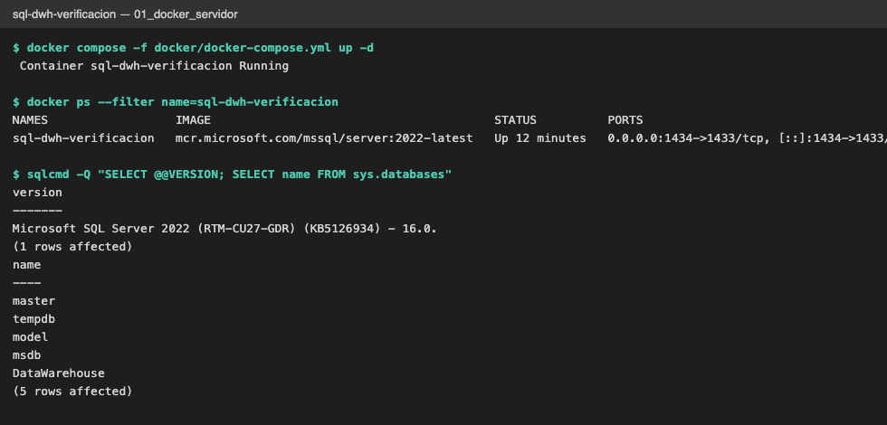
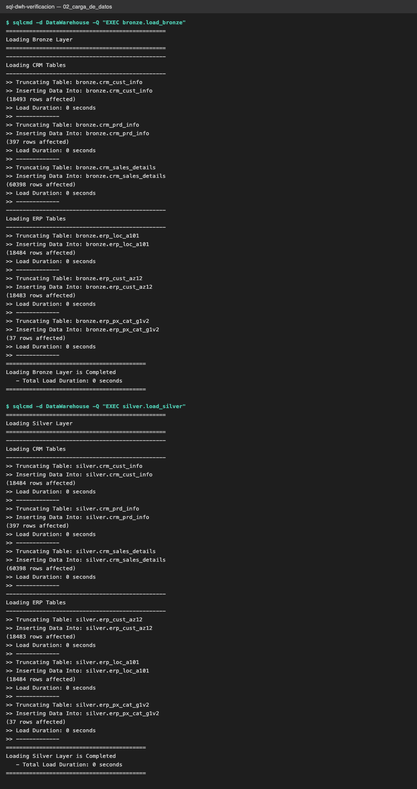
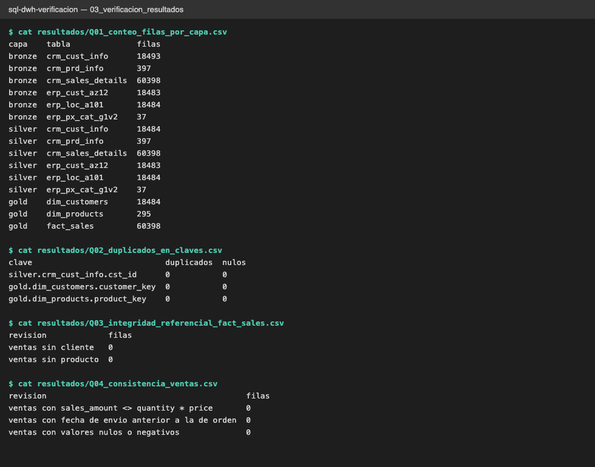
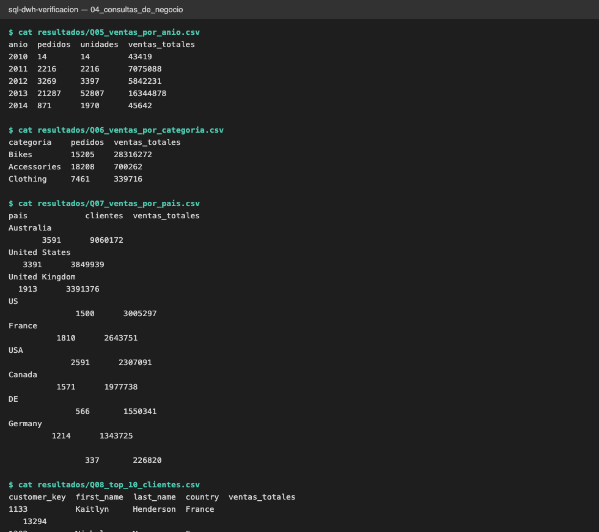

# 05_verificacion: Verificación del Data Warehouse (SQL Server en Docker)

Verificación del proyecto original (carpetas `00_setup` a `04_tests` en la raíz del repo): arquitectura medallón (bronze → silver → gold) con datos de un CRM y un ERP. Los comandos se ejecutan desde esta carpeta.

**Equipo:** Cruz Gutiérrez Edgar Omar y Rodriguez Muñoz Salma Annette

## Contenido

| Ruta | Qué es |
|---|---|
| `docker/docker-compose.yml` | SQL Server 2022 en Docker (puerto host 1434) |
| `sql/consultas_verificacion.sql` | 8 consultas de verificación |
| `ejecutar.sh` | Ejecuta las consultas y genera un CSV por consulta |
| `resultados/*.csv` | Resultados de cada consulta |
| `capturas/*.png` | Capturas del servidor, la carga y la verificación |

## Cómo reproducirlo

1. Levantar SQL Server: `docker compose -f docker/docker-compose.yml up -d`
2. Copiar `../01_datasets` a `/sql/dwh_project/01_datasets/` dentro del contenedor (las rutas del `BULK INSERT`).
3. Ejecutar, dentro de la base `DataWarehouse`, los scripts de `../03_scripts` en este orden: `init_database.sql`, `ddl_bronze.sql`, `proc_load_bronze.sql`, `ddl_silver.sql`, `proc_load_silver.sql`, `ddl_gold.sql`, y luego `EXEC bronze.load_bronze` y `EXEC silver.load_silver`.
4. `./ejecutar.sh` para regenerar los CSV.

La contraseña `sa` del compose es solo para uso local de práctica.

## Resultados

- **Cargas:** bronze 60,398 ventas; silver y gold conservan las 60,398. `crm_cust_info` pasa de 18,493 a 18,484 filas en silver (se eliminan duplicados).
- **Claves:** sin duplicados ni nulos en `cst_id`, `customer_key` y `product_key`.
- **Integridad:** ninguna venta sin cliente ni producto; `sales_amount = quantity * price` en todas las filas; ninguna fecha de envío anterior a la de orden.
- **Observación:** `Q07_ventas_por_pais` muestra que el campo `country` llega sin normalizar a gold (`US`, `USA` y `United States` por separado; `DE` y `Germany`; y un grupo de países vacíos). No es un error de la carga: es un punto de limpieza pendiente en la capa silver del proyecto original.

## Capturas

**1. Servidor SQL Server levantado con Docker**

**2. Carga de datos (bronze y silver)**

**3. Comprobación de resultados (conteos, claves, integridad, consistencia)**

**4. Consultas de negocio sobre la capa gold**

